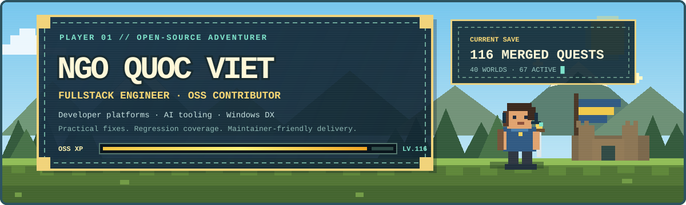
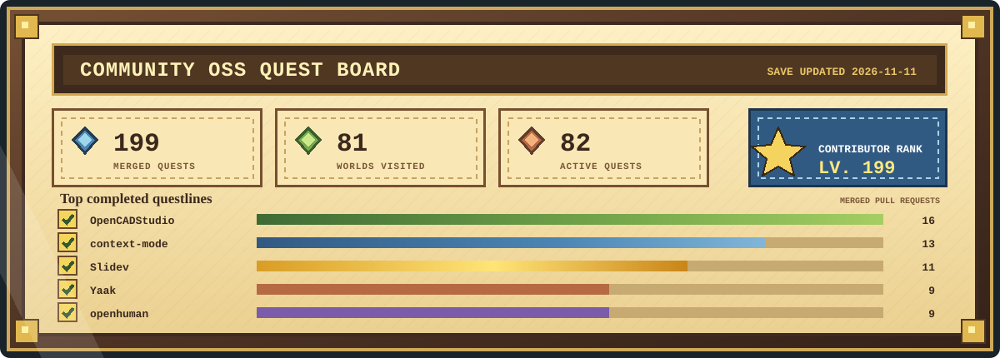

## 🧙 Player Profile

I'm **Ngo Quoc Viet**, a fullstack engineer who spends a large part of his engineering time shipping practical fixes to public open-source projects.

| Character stat | Current build |
| --- | --- |
| **Class** | Fullstack Engineer / OSS Contributor |
| **Experience** | Nearly 4 years across product and outsourced projects |
| **Party role** | Project-level Dev Lead experience in healthcare systems |
| **Main quests** | Developer platforms, AI tooling, MCP, desktop apps, Windows DX |
| **Play style** | Reproduce the issue → ship a narrow fix → add regression coverage → follow through on review |

My favorite contributions are the ones maintainers can immediately use: broken runtime paths, cross-platform bugs, stale setup flows, incorrect API behavior, missing safety checks, and tests that prevent the same regression from returning.

## 📊 Adventure Log

Public contribution data for [`NgoQuocViet2001`](https://github.com/NgoQuocViet2001), refreshed **2026-07-23**. The merged count covers authored PRs accepted into community-owned repositories.

  

| Stat | Total | Meaning |
| --- | ---: | --- |
| **Merged quests** | **47** | External PRs merged by community maintainers |
| **Worlds visited** | **13** | Community repositories with at least one merged contribution |
| **Active quests** | **30** | External PRs currently open for maintainer review |

## ⚔️ Latest Quests Cleared

| Project | PR | Quest result | Merged |
| --- | --- | --- | --- |
| [Project Nomad](https://github.com/Crosstalk-Solutions/project-nomad) | [#1091](https://github.com/Crosstalk-Solutions/project-nomad/pull/1091) | Resolves curated ZIM downloads against the live Kiwix catalog, while preserving safe manifest fallbacks and correct numeric version ordering. | 2026-07-21 |
| [Open Generative AI](https://github.com/Anil-matcha/Open-Generative-AI) | [#268](https://github.com/Anil-matcha/Open-Generative-AI/pull/268) | Refreshes missing submodule pins so a clean recursive checkout and the documented setup path work again. | 2026-07-14 |
| [Slidev](https://github.com/slidevjs/slidev) | [#2667](https://github.com/slidevjs/slidev/pull/2667) | Exposes reactive current-slide frontmatter through the navigation API for global layers and shared components. | 2026-07-14 |
| [Slidev](https://github.com/slidevjs/slidev) | [#2669](https://github.com/slidevjs/slidev/pull/2669) | Awaits Cypress `after:run` cleanup correctly, preserving the task contract and removing the configuration type error. | 2026-07-14 |
| [OpenHuman](https://github.com/tinyhumansai/openhuman) | [#4805](https://github.com/tinyhumansai/openhuman/pull/4805) | Rejects AppImage bundles missing the CEF runtime before release, with failure-path regression coverage. | 2026-07-14 |
| [GitHub Spec Kit](https://github.com/github/spec-kit) | [#3472](https://github.com/github/spec-kit/pull/3472) | Marks Kiro as safe for compatible multi-installs and adds a dedicated contract test. | 2026-07-13 |
| [Slidev](https://github.com/slidevjs/slidev) | [#2664](https://github.com/slidevjs/slidev/pull/2664) | Applies addon preparsers during the initial load so the first render matches later updates. | 2026-07-13 |
| [Next AI Draw.io](https://github.com/DayuanJiang/next-ai-draw-io) | [#890](https://github.com/DayuanJiang/next-ai-draw-io/pull/890) | Replaces a brittle 30-second edit gate with content comparison, allowing slow reasoning while still detecting unseen manual edits. | 2026-07-12 |
| [Logto](https://github.com/logto-io/logto) | [#9143](https://github.com/logto-io/logto/pull/9143) | Logs tenant initialization failures before returning the error response and covers the rejection path. | 2026-07-10 |
| [Paperless-ngx](https://github.com/paperless-ngx/paperless-ngx) | [#13052](https://github.com/paperless-ngx/paperless-ngx/pull/13052) | Counts each affected document once per severity while preserving the message-level total issue count. | 2026-06-27 |

## 🏰 Guild History

| Community project | Merged quests | Contribution territory |
| --- | ---: | --- |
| [mksglu/context-mode](https://github.com/mksglu/context-mode) | **13** | Codex/MCP reliability, Windows shells, plugin installs, analytics, cache behavior, docs, and regression coverage |
| [CJackHwang/ds2api](https://github.com/CJackHwang/ds2api) | **8** | OpenAI-compatible routes, streaming, citations, tool output, Vercel sync, and file metadata |
| [tinyhumansai/openhuman](https://github.com/tinyhumansai/openhuman) | **7** | Desktop OAuth, deep links, packaging, startup cleanup, RPC security, and AppImage release safety |
| [Anil-matcha/Open-Generative-AI](https://github.com/Anil-matcha/Open-Generative-AI) | **5** | Local AI model storage, onboarding, endpoint fallback, startup feedback, and reproducible setup |
| [slidevjs/slidev](https://github.com/slidevjs/slidev) | **4** | Base-path routing, reactive frontmatter, addon preprocessing, and Cypress lifecycle cleanup |
| [ruvnet/RuView](https://github.com/ruvnet/RuView) | **2** | ESP32 swarm configuration validation and mesh-to-dashboard documentation |
| [github/spec-kit](https://github.com/github/spec-kit) | **2** | Development agent symlinks and safe Kiro multi-install behavior |
| [supertone-inc/supertonic](https://github.com/supertone-inc/supertonic) | **1** | Multi-language CLI option documentation |
| [paperless-ngx/paperless-ngx](https://github.com/paperless-ngx/paperless-ngx) | **1** | Sanity-check data correctness and regression coverage |
| [logto-io/logto](https://github.com/logto-io/logto) | **1** | Tenant initialization error observability |
| [DayuanJiang/next-ai-draw-io](https://github.com/DayuanJiang/next-ai-draw-io) | **1** | MCP diagram edit consistency and stale-state protection |
| [Crosstalk-Solutions/project-nomad](https://github.com/Crosstalk-Solutions/project-nomad) | **1** | Offline content download reliability |
| [HyFrog/insight](https://github.com/HyFrog/insight) | **1** | Earlier application development contribution |

## 🔥 Active Quest Queue

Some of the current work waiting for maintainer review:

| Project | PR | Quest in progress |
| --- | --- | --- |
| [Vite](https://github.com/vitejs/vite) | [#22941](https://github.com/vitejs/vite/pull/22941) | Add Rollup-compatible `onLog` hooks to the dev plugin container, including filtering, re-emission, ordering, and lazy-log coverage. |
| [Visual Studio Code](https://github.com/microsoft/vscode) | [#325925](https://github.com/microsoft/vscode/pull/325925) | Propagate real `asExternalUri` resolver failures while preserving the normal unhandled-HTTP fallback. |
| [Visual Studio Code](https://github.com/microsoft/vscode) | [#325897](https://github.com/microsoft/vscode/pull/325897) | Enable the extension-host inspector before launching the debug flow. |
| [VS Code CSS Language Service](https://github.com/microsoft/vscode-css-languageservice) | [#496](https://github.com/microsoft/vscode-css-languageservice/pull/496) · [#497](https://github.com/microsoft/vscode-css-languageservice/pull/497) · [#498](https://github.com/microsoft/vscode-css-languageservice/pull/498) · [#499](https://github.com/microsoft/vscode-css-languageservice/pull/499) | Modern RGB completions, ICSS lint correctness, comment-aware suggestions, and `place-items` value completions. |
| [Codex Plugin](https://github.com/openai/codex-plugin-cc) | [#504](https://github.com/openai/codex-plugin-cc/pull/504) | Report explicit job lookups as active while jobs are queued or running. |
| [olmOCR](https://github.com/allenai/olmocr) | [#469](https://github.com/allenai/olmocr/pull/469) | Write Markdown exports as UTF-8 so Unicode content works on Windows systems with non-UTF default encodings. |
| [context-mode](https://github.com/mksglu/context-mode) | [#907](https://github.com/mksglu/context-mode/pull/907) | Keep session-start and snapshot truncation safe at Unicode surrogate-pair boundaries. |

## 🎒 Inventory / Tech Stack

  

| Inventory slot | Equipped tools |
| --- | --- |
| **Frontend** | JavaScript, TypeScript, React, Vue, Next.js, Vite, Tailwind CSS |
| **Backend** | Node.js, C#, ASP.NET, PHP, Laravel, Python, Java, Go, Rust |
| **Data stores** | MySQL, PostgreSQL, MongoDB, Redis |
| **Infrastructure** | AWS, Linux, Docker, Nginx, CI/CD, GitHub Actions, VPS operations |
| **AI developer tooling** | Codex, MCP, Claude Code, OpenAI-compatible APIs, agent workflows |
| **Product toolkit** | Git, GitHub, Figma, Postman, VS Code |

## 🧭 Preferred Quest Types

- **AI developer tooling:** MCP servers, Codex integrations, context optimization, local analytics, safe upgrade paths.
- **Windows-first reliability:** PowerShell, `pwsh`, `cmd`, Git Bash, WSL, symlink restrictions, desktop deep links, packaging quirks.
- **API and data correctness:** OpenAI-compatible routes, streaming behavior, file metadata, citation markers, validation, and counting semantics.
- **Release safety:** dependency checks, runtime guards, reproducible setup, CI and test lifecycle fixes.
- **Maintainer-friendly delivery:** narrow diffs, issue-backed scope, concrete tests, concise validation, and follow-up fixes.

## 🛠️ Personal Artifacts

| Project | What it equips |
| --- | --- |
| [codex-keyring](https://github.com/NgoQuocViet2001/codex-keyring) | Native multi-account manager for Codex with aliases, health checks, and failover support |
| [codex-observatory](https://github.com/NgoQuocViet2001/codex-observatory) | Local Codex usage analytics, token trends, model breakdowns, and dashboard views |
| [google-workspace-mcp](https://github.com/NgoQuocViet2001/google-workspace-mcp) | MCP server for structured Google Docs and Sheets extraction with image-aware output |

## 📜 Character Background

- Fullstack delivery across product and outsourced environments, with project bootstrapping, reusable component design, code review, Git flow, mentoring, and internal training.
- Project-level Dev Lead experience in healthcare systems, including BA/QC/developer coordination and legacy-parity work.
- Hands-on deployment and support across AWS, Linux, Docker, Nginx, CI/CD, VPS, staging, and production environments.
- AWS Certified Solutions Architect – Associate, scored **861/1000**.

## 📬 Party Invite

Open to OSS collaboration, maintainer support, developer tooling, automation, and practical fullstack/internal-tool work.

[Portfolio](https://viet-ngo.hinadau.vip) · [GitHub](https://github.com/NgoQuocViet2001) · [Zalo](https://zalo.me/0971933518) · [Facebook](https://www.facebook.com/ngoquocviet2001/)
